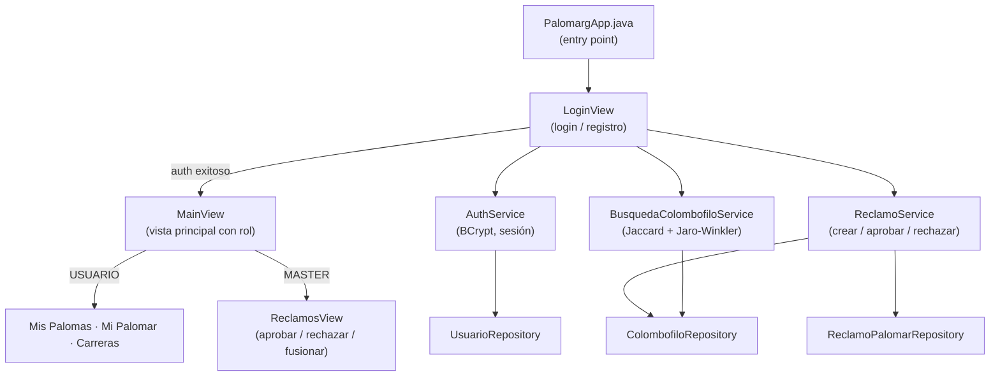
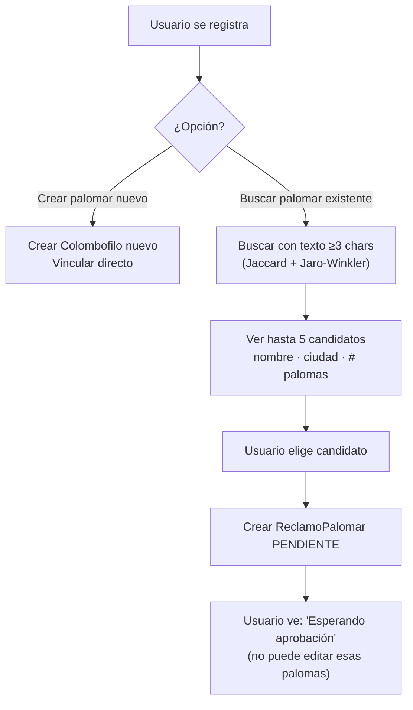
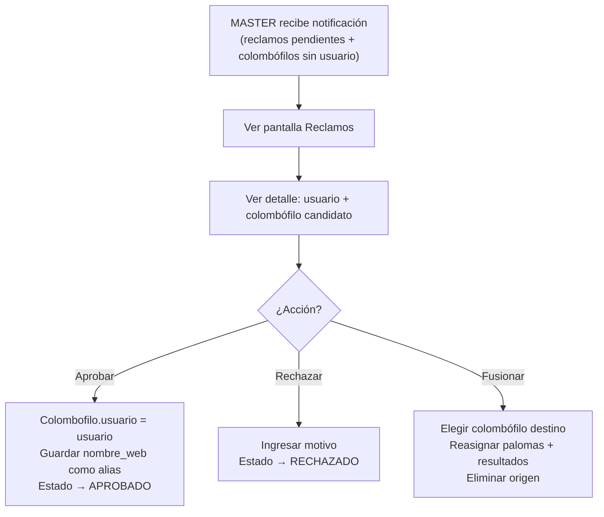

# PalomARG – FASE 2: Cuentas y Vinculación de Palomar

## Arquitectura general



## Componentes a implementar

| # | Archivo | Estado |
|---|---------|--------|
| 1 | `pom.xml` – agregar BCrypt | ✅ Listo |
| 2 | `service/AuthService.java` | ✅ Listo |
| 3 | `service/BusquedaColombofiloService.java` | ✅ Listo |
| 4 | `service/ReclamoService.java` | ✅ Listo |
| 5 | `view/LoginView.java` | ✅ Listo |
| 6 | `view/ReclamosView.java` | ✅ Listo |
| 7 | `controller/MainController.java` (actualizado) | ✅ Listo |
| 8 | `view/MainView.java` (actualizado) | ✅ Listo |
| 9 | `PalomargApp.java` (actualizado) | ✅ Listo |
| 10 | `database/DatabaseManager.java` (usuario MASTER) | ✅ Listo |
| 11 | `css/styles.css` (estilos nuevos) | ✅ Listo |

> **`mvn compile` → BUILD SUCCESS** ✅

## Flujo de Registro



## Flujo de Aprobación MASTER



## Algoritmo de Búsqueda Difusa

```
score = 0.6 × Jaccard(tokens_query, tokens_candidato)
      + 0.4 × JaroWinkler(query_normalizado, nombre_candidato_normalizado)
      + 0.2  (si código [n] coincide)
      + 0.1  (si ciudad/localidad coincide)

Normalización:
  - minúsculas, sin tildes, espacios colapsados
  - quitar conectores: "y", "e", "hijos", "familia", "hnos", "de", "del", "los", "las"

Solo candidatos con id_usuario IS NULL
Devuelve hasta 5, ordenados por score desc
```

## Reglas de negocio críticas

> [!IMPORTANT]
> **Nunca vincular automáticamente.** Todo vínculo Colombofilo↔Usuario requiere aprobación explícita del MASTER.

> [!WARNING]
> **Conflicto de anillo**: si una paloma tiene dueño y llega una importación con el mismo anillo para otro colombófilo → NO sobreescribir → abrir reclamo.

> [!NOTE]
> **Fusión**: si el usuario creó un palomar manual y llega importación con el mismo colombófilo → ofrecer "fusionar" en lugar de duplicar.

## Credenciales por defecto (datos de ejemplo)

| Usuario | Password | Rol |
|---------|----------|-----|
| `master` | `master123` | MASTER |

